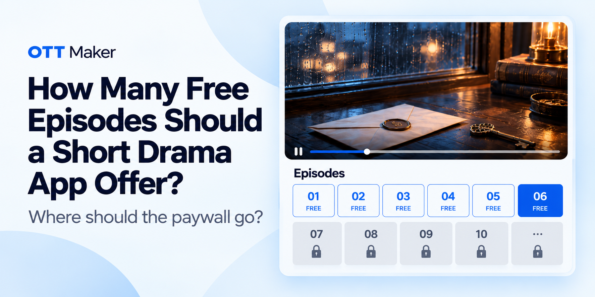
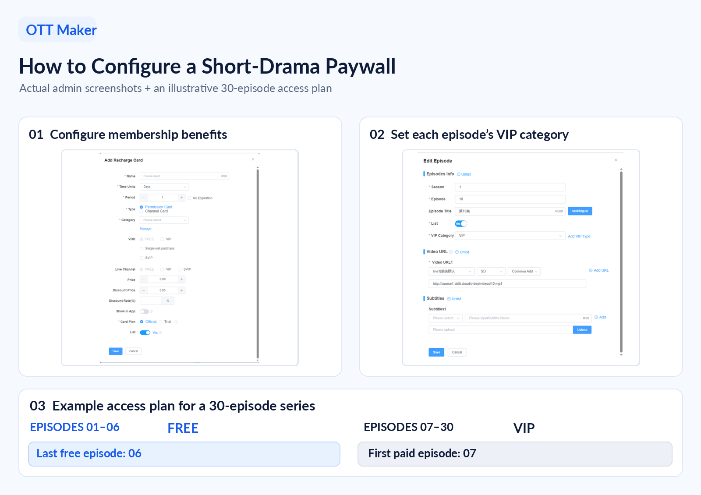

# How Many Free Episodes Should a Short Drama App Offer? Where Should the Paywall Go?

Offer too many episodes for free, and viewers may leave after the biggest cliffhanger has already been resolved. Offer too few, and they may hit the paywall before they care about the story. So how many episodes should be free? The first step is to avoid copying another short drama app’s number without considering your own series.

If you are launching a short drama app, you need a starting point that fits your story, your audience, and your monetization model. This article looks at how to choose a paywall position, set it up, and test whether it works.

## Contents

- [Why Does the Number of Free Episodes Affect Revenue?](#why-does-the-number-of-free-episodes-affect-revenue)
- [Is There a Standard Number of Free Episodes?](#is-there-a-standard-number-of-free-episodes)
- [Three Factors That Determine How Many Episodes to Offer for Free](#three-factors-that-determine-how-many-episodes-to-offer-for-free)
- [How to Test and Find Your Number](#how-to-test-and-find-your-number)
- [How to Set Up Your Paywall in OTT Maker](#how-to-set-up-your-paywall-in-ott-maker)
- [Conclusion](#conclusion-the-free-episode-count-is-a-starting-point-not-a-fixed-rule)

## Why Does the Number of Free Episodes Affect Revenue?

Imagine you have just launched a revenge drama. A viewer starts watching but encounters a paywall after the first episode. They might close the app within seconds: they understand the premise, but they have not had time to become invested in the characters.

Now imagine the opposite. You offer 15 episodes for free. The viewer finishes the first major story arc, sees the cheating husband get his comeuppance, and closes the app. The moment they most wanted to see has already happened, so they have little reason to pay for the next episode.

Both choices can cost you revenue. In the first case, you ask for payment before the viewer is invested. In the second, you may give away the story’s strongest payoff. The difference is where you draw the line.

## Is There a Standard Number of Free Episodes?

There is no ideal number that works for every short drama. Looking at similar apps can help you choose an initial range. For example:

- DramaBox offers 6–10 free episodes.
- ReelShort offers 5–12 free episodes, depending on the series.
- Many Chinese short drama apps make the first five episodes free and place the paywall at episode six.

Those numbers are useful references, but the final decision should come back to your own story and audience.

Genre can help you form an initial hypothesis. For a revenge drama or a romance built around immediate conflict, you might test an earlier paywall if the first few episodes already create a strong cliffhanger. For a slower romance or a slice-of-life story, you might give viewers more free episodes if they need time to care about the characters.

Rather than searching for one industry average, look at two moments in your series: when viewers become invested, and when they most want to know what happens next. The right starting position will also depend on your target audience and how you plan to charge.

## Three Factors That Determine How Many Episodes to Offer for Free

### Factor 1: Where Does the Story’s Hook Land?

Genre gives you a starting point, but it should not determine the free-episode count by itself. The more useful question is: at what point does your story make viewers think, “I need to know what happens next”?

In a revenge drama involving a broken family or a hidden heir, the first episode might grab attention immediately. If a strong unresolved twist comes soon afterward, you can test an earlier paywall.

In a slow-burn romance, viewers may need several episodes to care about the main characters. You can place the paywall after the central relationship has taken shape.

In a mystery, the opening episodes may be needed to establish the puzzle. Give viewers enough time to understand what is at stake, then test a paywall at a point where an important question remains unanswered.

Here is a simple exercise: watch your own series and mark the episode endings that make you feel you need to see what happens next. Those are your potential paywall positions.

### Factor 2: Your Target Market

The number of free episodes does not have to be the same in every market. Viewers may have different expectations about pricing, payment methods, and how much they can watch before paying. When entering a new market, learn how your intended audience actually behaves, then test your paywall position.

For example, viewers in North America and Europe are generally more accustomed to paying for content, while willingness to pay may be lower in Southeast Asia and Latin America.

### Factor 3: Your Monetization Model

How you earn revenue affects what the free episodes need to do:

- **Pay per episode:** The free portion should make viewers want to unlock the next episode. The price and what it unlocks should be clear.

- **Monthly subscription:** The free portion needs to show that the rest of the series, and the content available with a membership, are worth paying for.

- **Ad-supported viewing (AVOD):** If advertising is your main source of revenue, consider viewing time and the ad experience when deciding how much content to offer for free.

- **Hybrid model:** If viewers can pay with coins, watch an ad to unlock an episode, or choose another access option, make it clear what each option provides.

## How to Test and Find Your Number

Industry examples can give you a starting point. What viewers watch and buy after launch will tell you whether your initial paywall position works.

### Step 1: See Where Viewers Drop Off

If you have episode-level viewing data, look for the episodes where viewership falls sharply. If many viewers leave in the first few episodes, the opening or viewing experience may need work. Moving the paywall will not necessarily solve that problem.

If viewers continue watching until they reach the paywall, the story is holding their attention. That is when it becomes more useful to test the access rules or pricing.

### Step 2: Check Whether the Paywall Comes at the Right Moment

If many viewers reach the paywall but few purchase access, try moving it back one or two episodes to give them more time to become emotionally invested. On the other hand, if the free episodes resolve a major story arc and viewers leave after watching it, try placing the paywall earlier.

The point is not simply which episode number you choose. It is whether viewers reach the paywall while they still feel a strong need to know what happens next.

### Step 3: Do Not Look Only at the Conversion Rate

Consider two hypothetical paywall tests for the same short drama, using comparable audience groups of 5,000 viewers each.

- **Test A:** Episode 5 is the **first paid episode**.
- **Test B:** Episode 7 is the **first paid episode**.

| Metric | Test A: Episode 5 first paid | Test B: Episode 7 first paid |
| --- | ---: | ---: |
| Starting audience | 5,000 | 5,000 |
| Viewers reaching the paywall | 2,000 | 1,000 |
| Conversion rate at the paywall | 8% | 10% |
| Viewers who purchase | **160** | **100** |
| Purchase rate across starting audience | **3.2%** | **2.0%** |

Although Episode 7 has a higher paywall conversion rate, Episode 5 generates **60 more purchases**.

This illustrates why paywall conversion rate alone is not enough to determine the better position. Operators should also compare the number of viewers reaching the paywall, purchases relative to the starting audience, revenue, and retention after purchase.

*These figures are illustrative, not actual test results. The better paywall position must be determined through testing with comparable audience groups and consistent conditions.*

A paywall should follow the rhythm of the story. A good starting point for testing is a moment when viewers already care about the characters but are still waiting for a major reveal. Instead of asking only, “How many episodes should be free?”, ask, “At which point would my viewers least want to stop?” Find that moment, then test it against actual behavior.

## How to Set Up Your Paywall in OTT Maker

*OTT Maker recharge-card and episode-setting screens, alongside an illustrative 30-episode access plan. The access plan is an example, not a screenshot of saved settings.*

Once you have chosen a point in the story, the next step is to apply it to episode access. In OTT Maker, episodes within the same series can be set to FREE, VIP, or SVIP. Viewers can watch the opening portion for free, while the episodes after your chosen boundary require the corresponding access rights.

### Step 1: Set Up Your Membership Offer

Go to **Recharge Card List** to create or edit a card. Set its price and validity period, then select the relevant **VOD VIP** or **SVIP** benefits.

Before changing episode permissions, decide what viewers will be able to watch after purchasing access and how long that access will last. Even viewers who want to continue the story may hesitate if the membership benefits are unclear.

### Step 2: Set Access for Each Episode

Go to **VOD Management → Video List**, find the series, and open **Episode Management**. There you can see each episode’s number, title, and VIP category, and review or change its access setting.

Suppose your series has 30 episodes and you decide to offer the first six for free. Set episodes 1–6 to FREE and episodes 7–30 to VIP. That puts the paywall at the point you chose in the story.

| Episode range | Access category |
| --- | --- |
| 1–6 | **FREE** |
| 7–30 | **VIP** |

Pay particular attention to the two episodes on either side of the boundary: episode six must be FREE, and episode seven must be VIP. If either one is set incorrectly, viewers will encounter the paywall in the wrong place.

### Step 3: Import a New Series in Bulk

If a series has dozens of episodes, entering and setting them one by one takes time. You can use the **Bulk Import** template to enter the episode number, title, video URL, and other information in each row. In the **VIP Category** column, specify the access level for each episode.

For the six-free-episode example, enter FREE for episodes 1–6 and VIP from episode seven onward, then import the file. Afterward, check the opening episode, episodes six and seven, and the final episodes to confirm that both the order and the access settings are correct.

### Step 4: Decide Whether to Adjust After Launch

Let the series run for a period, then review its performance. OTT Maker’s analytics let you search VOD content by name and export data for further analysis.

If you also have episode-level viewing and membership purchase records, use them to see whether viewers leave during the free portion or reach VIP episodes without purchasing access. If they leave early, look at the opening and viewing experience first. If they reach the paid portion but do not buy, review the cliffhanger before the paywall, the membership price, and how clearly the benefits are explained.

If you decide to adjust the free portion, move the boundary by one or two episodes, record the date of the change, and compare viewing and purchasing behavior before and after.

## Conclusion: The Free-Episode Count Is a Starting Point, Not a Fixed Rule

How many episodes you offer for free depends on when viewers most want to see the next one. Identify the key moment in the story, consider your target market and monetization model, and choose an initial paywall position. After launch, review viewing and purchase behavior and adjust the FREE/VIP boundary if needed. Even within the same app, different series may need different numbers of free episodes.

In OTT Maker, you can set FREE, VIP, or SVIP access for individual episodes in Episode Management or specify the access level during bulk import. You can then use VOD data to help review the results. That turns a proposed paywall position into an access rule you can set, check, and refine.

Planning the free-to-paid transition for a short drama app? [Explore OTT Maker](https://www.ottmaker.com/).
